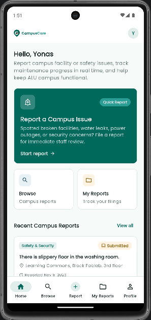
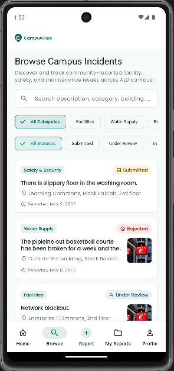
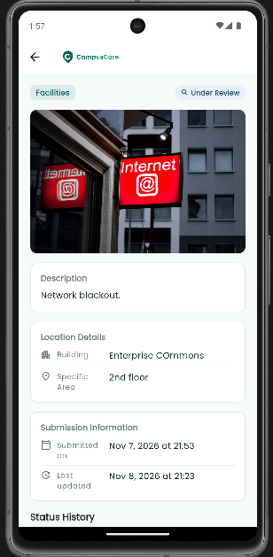
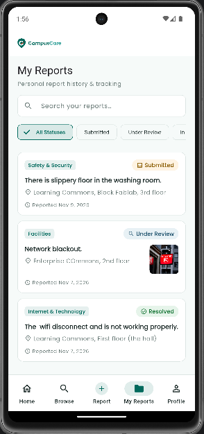
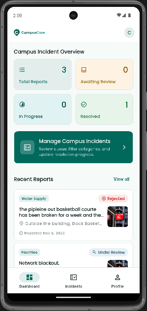
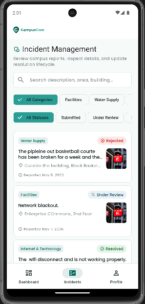

# CampusCare

**Report. Track. Resolve.**

[](https://flutter.dev)
[](https://dart.dev)
[](https://firebase.google.com)
[](https://firebase.google.com/docs/firestore)
[](https://riverpod.dev)
[](https://pub.dev/packages/go_router)
[](https://cloudinary.com)

CampusCare is a university campus incident reporting mobile application engineered for the African Leadership University (ALU) community. The application bridges the communication gap between students and campus administration by enabling students to report facility, safety, and maintenance issues in real time while providing campus operations staff with a dedicated incident management portal to triage, update, and resolve issues with complete transparency.

---

## Demonstration Video

Demo video: https://youtu.be/R0Nu7pJ7yfc.

---

## Application Previews

| Student Dashboard | Incident Discovery & Browse | Incident Details & Timeline |
| :---: | :---: | :---: |
|  |  |  |

| Personal Reports & Tracking | Staff Overview & Metrics | Staff Queue & Resolution |
| :---: | :---: | :---: |
|  |  |  |

---

## Key Features

### Student Experience

- **Domain-Restricted Authentication:**
  - Secure email/password registration and Google Sign-In strictly gated to eligible `@alustudent.com` institutional domains.
  - Mandatory email verification enforcement before accessing campus incident data.
  - Automatic Firestore student profile generation and persistence.
- **Home Dashboard & Application Shell:**
  - Persistent 5-destination bottom navigation shell (`Home`, `Browse`, `Report`, `My Reports`, `Profile`).
  - Personalized student greeting, emergency quick-action card, category shortcuts, campus maintenance bulletins, and a preview of recent campus reports.
  - Circular app bar avatar providing one-tap navigation to the student profile.
- **Incident Reporting & Media Uploads:**
  - Structured submission flow supporting 6 core campus categories (Facilities, Electrical, Water Supply, Safety, IT & Network, Cleanliness).
  - Explicit campus location mapping: Building, Block/Wing, and Specific Area.
  - Optional incident photograph attachments with client-side file validation (JPG, JPEG, PNG, WebP; 5 MB maximum).
  - Unsigned media uploads via Cloudinary with a resilient text-only reporting fallback if media services are unconfigured.
- **Campus-Wide Discovery & Search:**
  - Public chronological incident feed ordered newest first.
  - Real-time case-insensitive keyword search across descriptions, categories, buildings, blocks, and specific areas.
  - Interactive status and category filter chips with an active filter summary and one-tap reset.
  - Server-side cursor-based pagination (20 reports per page) using Firestore document cursors (`startAfterDocument`).
- **Incident Details & Transparent Audit History:**
  - Comprehensive report views displaying categories, location paths, timestamps, and full-resolution photographs.
  - Chronological status history rendered from the `status_history` audit subcollection, displaying timestamps, lifecycle stages, and staff remarks.
  - Privacy preservation: student reporter identity and contact info remain strictly confidential and hidden from campus-wide listings.
- **My Reports & Session-Isolated Tracking:**
  - Dedicated personal report tracking view listing only issues submitted by the authenticated student.
  - Dynamic status filtering, keyword search, and pull-to-refresh.
  - Session-isolated state lifecycle in Riverpod: prevents stale report leakage or filter carryover across account switches.
- **Student Profile:**
  - Account credential details, verification status indicator, institutional privacy notice, and sign-out flow.

### Staff Experience

- **Role-Based Access Control & Staff Verification:**
  - Authentication restricted to official `@alueducation.com` email addresses.
  - Role verification queried directly from the Firestore `users` collection.
  - Automatic redirection of unprovisioned staff accounts to a dedicated authorization rejection screen.
- **Role-Specific Persistent Bottom Navigation:**
  - Persistent 3-destination navigation shell (`Dashboard`, `Incidents`, `Profile`) mirroring the CampusCare design system.
  - Cross-role route guards: prevents unauthorized cross-navigation between student and staff routes in GoRouter.
- **Staff Operations Dashboard:**
  - Real-time incident metrics calculated using Firestore aggregation queries (`count().get()`):
    - **Total Reports**
    - **Awaiting Review**
    - **In Progress**
    - **Resolved**
  - High-visibility action card to open the management queue and a preview of the newest submissions across campus.
- **Campus Incident Management Queue:**
  - Full-screen incident triage queue with dedicated category and status filter chips.
  - Direct access to individual incident records for immediate status updates.
- **Atomic Incident Status Lifecycle Management:**
  - Staff can advance incident lifecycle stages: **Under Review**, **In Progress**, **Resolved**, and **Rejected**.
  - Mandatory remarks requirement enforced when rejecting reports to provide actionable context to student reporters.
  - Atomic batch writes (`WriteBatch`): updates the parent incident status while simultaneously appending an immutable audit record to the `status_history` subcollection.
- **Dedicated Staff Profile:**
  - Staff badge, institutional contact details, operational review notice, and sign-out.

---

## Technology Stack & Architecture

### Core Technologies

| Layer | Technology | Details |
| :--- | :--- | :--- |
| **Framework** | [Flutter](https://flutter.dev) (v3.13+) | Cross-platform mobile development (Material 3) |
| **Language** | [Dart](https://dart.dev) (SDK `^3.13.5`) | Type-safe, null-safe object-oriented language |
| **State Management** | [Flutter Riverpod](https://riverpod.dev) (`^3.5.0`) | Unidirectional, reactive, compile-safe state management |
| **Navigation** | [GoRouter](https://pub.dev/packages/go_router) (`^18.1.3`) | Declarative routing with stateful nested shells and auth redirects |
| **Authentication** | [Firebase Auth](https://firebase.google.com/docs/auth) (`^7.0.1`) | Email/password and Google Sign-In with domain validation |
| **Database** | [Cloud Firestore](https://firebase.google.com/docs/firestore) (`^7.1.0`) | NoSQL document database with security rules and aggregation queries |
| **Media Storage** | [Cloudinary](https://cloudinary.com) (`http: ^1.6.0`) | Unsigned multipart REST image uploads (approved alternative) |
| **Image Picker** | [image_picker](https://pub.dev/packages/image_picker) (`^1.2.4`) | Camera and gallery photograph selection |
| **Typography** | [google_fonts](https://pub.dev/packages/google_fonts) (`9.0.0`) | Official Poppins font family across all display typography |
| **Branding & Icons** | [flutter_svg](https://pub.dev/packages/flutter_svg) (`^2.3.2`) | Resolution-independent SVG logo rendering and Material icons |

### Architectural Pattern

CampusCare adheres to a **feature-first layered architecture**. Business domains are organized into dedicated feature modules containing four distinct layers:

```text
lib/
├── app/                  # Application configuration, routing, and theme
│   ├── router/           # GoRouter declarations, stateful shells, and auth guards
│   └── theme/            # Material 3 theme palette, typography, and AppColors
├── core/                 # Shared utilities, constants, strings, and helpers
│   ├── constants/        # Application strings, assets, and route definitions
│   └── utils/            # Formatting and date helpers
├── features/             # Feature-first modular packages
│   ├── authentication/   # Auth controller, state, domain models, and screens
│   ├── dashboard/        # Student home, staff dashboard, and shell wrappers
│   ├── incidents/        # Incident domain models, repositories, controllers, and screens
│   └── profile/          # Student and staff dedicated profile screens
└── shared/               # Reusable presentation components
    └── widgets/          # Brand logo, custom buttons, text fields, and chips
```

Each feature follows strict unidirectional data flow:
- **Domain:** Pure Dart models, enums, and business logic without UI or framework dependencies.
- **Data:** Repositories, data sources, and external API services (Firestore and Cloudinary).
- **Application:** Riverpod controllers (`Notifier` / `AsyncNotifier`) managing view state and business actions.
- **Presentation:** Stateless and Stateful consumer widgets, screens, and modals.

---

## Directory Structure

```text
campus_incident_reporting_app/
├── android/                  # Android native project configuration
├── assets/
│   ├── branding/             # CampusCare SVG logo variants and brand marks
│   └── screenshots/          # Application walkthrough demonstration screenshots
├── lib/
│   ├── app/                  # App entrypoint, GoRouter, and theme definitions
│   ├── core/                 # Constants, strings, and validator utilities
│   ├── features/             # Authentication, Dashboard, Incidents, and Profile
│   ├── shared/               # Shared UI components and brand widgets
│   ├── firebase_options.dart # FlutterFire generated client configuration
│   └── main.dart             # Application initialization and ProviderScope root
├── test/
│   └── unit/                 # 117 automated unit and widget tests
│       ├── application/      # Auth state and controller tests
│       ├── incidents/        # Submission, filtering, pagination, and session isolation tests
│       ├── models/           # Domain model serialization and enum mapping tests
│       ├── services/         # ALU email validator and Cloudinary service tests
│       ├── staff/            # Staff dashboard, management queue, shell, and profile tests
│       └── student/          # Student dashboard, shell, profile, and recent reports tests
├── .env.example              # Example environment variable template for Cloudinary
├── .gitignore                # Version control exclusions
├── firebase.json             # Firebase CLI configuration for rules and indexes
├── firestore.indexes.json    # Composite index definition for user-scoped incident queries
├── firestore.rules           # Production security rules enforcing RBAC and atomic writes
└── pubspec.yaml              # Project manifest and package dependencies
```

---

## Prerequisites & Installation

### Prerequisites

- **Flutter SDK:** Version `3.13.5` or higher ([Installation Guide](https://docs.flutter.dev/get-started/install)).
- **Dart SDK:** `^3.13.5` (bundled with Flutter).
- **Android Studio** or **VS Code** with Flutter and Dart extensions.
- **Android SDK:** API Level 21 (Android 5.0 Lollipop) or higher.
- A physical Android device or Android Emulator configured.
- (Optional) **Firebase CLI** (`firebase-tools`) for deploying rules and indexes.

### Installation Steps

1. **Clone the repository:**
   ```bash
   git clone https://github.com/yonas-k-alazar/campus-incident-reporting-app.git
   cd campus-incident-reporting_app
   ```

2. **Install project dependencies:**
   ```bash
   flutter pub get
   ```

3. **Verify Flutter environment:**
   ```bash
   flutter doctor
   ```

---

## Configuration

### 1. Firebase Setup

CampusCare is pre-configured with the academic Firebase project `campuscare-alu`. The client configuration files are present in the repository:
- `lib/firebase_options.dart` (Dart client options for FlutterFire).
- `android/app/google-services.json` (Android client services configuration).

#### Authentication Providers
In the Firebase Console under **Authentication &rarr; Sign-in method**, ensure:
1. **Email/Password** is enabled (without Email link passwordless sign-in).
2. **Google** provider is enabled.

#### Google Sign-In Fingerprint Registration
For Google Sign-In on Android, your local debug SHA-1 signing fingerprint must be added to the Firebase Android App configuration. To generate your SHA-1 key:

```bash
# Windows (PowerShell)
cd android
./gradlew signingReport

# macOS / Linux
cd android
./gradlew signingReport
```

Copy the `SHA1` fingerprint under the `debugAndroidTest` or `debug` variant and register it in **Firebase Console &rarr; Project Settings &rarr; Your apps &rarr; com.campuscare.app &rarr; Add fingerprint**.

### 2. Cloudinary Setup (Image Uploads)

#### Facilitator-Approved Storage Solution
In the original assignment brief, Firebase Storage was mentioned for image uploads. Following explicit facilitator approval, **Cloudinary** was adopted as the approved media storage solution. Firebase Storage requires Google Cloud Blaze (pay-as-you-go credit card billing), which is inaccessible and cost-prohibitive for academic coursework. Cloudinary provides a reliable free tier with unsigned upload capabilities suitable for campus demonstration.

#### Unsigned Preset Configuration
1. Create a free account at [Cloudinary.com](https://cloudinary.com).
2. In the Cloudinary Console, navigate to **Settings &rarr; Upload Presets**.
3. Create a new upload preset:
   - **Signing Mode:** `Unsigned` (Required).
   - **Folder:** Optional (e.g., `campuscare_incidents`).
   - **Allowed formats:** `jpg, jpeg, png, webp`.
   - **Maximum file size:** `5 MB` (`5242880` bytes).

#### Passing Credentials via Compile-Time Flags
Cloudinary credentials are never committed to version control. Provide them at build or run time using `--dart-define`:

```bash
flutter run \
  --dart-define=CLOUDINARY_CLOUD_NAME=your_cloud_name \
  --dart-define=CLOUDINARY_UPLOAD_PRESET=your_upload_preset
```

Alternatively, copy `.env.example` to `.env`:
```bash
cp .env.example .env
```
Fill in your credentials in `.env`, and launch the app using `--dart-define-from-file`:
```bash
flutter run --dart-define-from-file=.env
```

> **Note on Text-Only Fallback:** If the Cloudinary configuration flags are omitted, CampusCare remains fully operational for text-only incident reports. The image picker informs the user that photo uploads are unavailable while preserving description and location submissions.

### 3. Firestore Rules & Composite Indexes

#### Security Rules
Security rules are defined in [`firestore.rules`](firestore.rules). They enforce:
- Institutional email domain verification (`@alustudent.com` or `@alueducation.com`).
- Mandatory email verification check (`request.auth.token.email_verified == true`).
- Role-based authorization: students can create incidents and read campus incidents; only staff can update incident status.
- Confidentiality: private reporter contact details are isolated in `/incidents/{id}/private/reporter` and are accessible only to the author student and campus staff.
- Atomic consistency: status history entries must match parent incident status updates in the same transaction or batch write (`get()` and `getAfter()`).

To deploy security rules using the Firebase CLI:
```bash
firebase deploy --only firestore:rules
```

#### Composite Indexes
For personal report queries (`createdBy == uid` ordered by `createdAt DESC`), Firestore requires a composite index defined in [`firestore.indexes.json`](firestore.indexes.json):

```json
{
  "indexes": [
    {
      "collectionGroup": "incidents",
      "queryScope": "COLLECTION",
      "fields": [
        { "fieldPath": "createdBy", "order": "ASCENDING" },
        { "fieldPath": "createdAt", "order": "DESCENDING" }
      ]
    }
  ],
  "fieldOverrides": []
}
```

To deploy indexes:
```bash
firebase deploy --only firestore:indexes
```

---

## Testing & Quality Assurance

CampusCare features a comprehensive test suite of **117 automated tests** spanning unit, model, controller, service, and widget verification.

### Running Tests

Execute the complete test suite:
```bash
flutter test
```

Execute static code analysis:
```bash
flutter analyze
```

### Test Coverage Highlights

- **Authentication & Validation:** Institutional email domain verification, role resolution, password validation, and auth state serialization.
- **Domain Models & Serialization:** `Incident`, `UserProfile`, `IncidentStatus`, `IncidentCategory`, and `IncidentStatusHistory` parsing and `toFirestore()` transformations.
- **Cloudinary Service:** Unsigned file format validation, 5 MB file size boundary checks, and error message mapping.
- **Incident Controllers:**
  - `IncidentSubmissionController`: Validating, uploading, submitting, and error phases.
  - `BrowseIncidentsController`: Client-side search matching, status/category filter logic, and cursor pagination.
  - `IncidentStatusUpdateController`: Staff atomic update execution, status validation, and rejection remark enforcement.
- **Session-State Isolation:** Cross-account state isolation in `MyReportsController`, verified filter resets, and prevention of race-condition overwrites.
- **Shell Navigation & UI:** Student 5-tab shell, Staff 3-tab shell, AppBar profile avatar actions, and bidirectional cross-role navigation guards in GoRouter.

---

## Security, Privacy & Known Limitations

### Security & Privacy Protections

1. **Email Domain Authorization:** Firebase Authentication combined with security rules rejects non-ALU email addresses (`@alustudent.com` and `@alueducation.com`).
2. **Reporter Identity Confidentiality:** The public incident document contains no student contact information. Personal reporter details are stored under `/incidents/{incidentId}/private/reporter`, protected by security rules permitting access exclusively to the creator and staff.
3. **Atomic Audit Logging:** Staff status transitions are committed in batch writes with `status_history` documents, preventing unrecorded status modifications.
4. **Credential Safety:** No service-account keys, API secrets, or private certificates are stored in the repository.

### Known Limitations

1. **Client-Side Search Over Paginated Batches:** Full-text keyword search operates over loaded Firestore batches. Because Cloud Firestore does not provide native partial string search, cursor-based pagination allows users to progressively fetch records while searching in-memory.
2. **Orphaned Media on Aborted Transactions:** If a Cloudinary upload succeeds but the subsequent Firestore batch write fails, the uploaded image cannot be deleted from the client application because deletion requires a secret API key that cannot be embedded in client binaries. This is an accepted trade-off documented and approved for this academic architecture.

---

## Academic Presentation & Assessment

CampusCare was designed and implemented for the **Mobile Application Development** course at the **African Leadership University (ALU)**.

### Demo Accounts for Assessment

| Role | Email Format | Access Scope |
| :--- | :--- | :--- |
| **Student** | `*@alustudent.com` | Report incidents, browse campus issues, track personal submissions, view profile |
| **Staff** | `*@alueducation.com` | Access staff dashboard, review management queue, update lifecycle status, add remarks |

---

## License

This project is submitted for academic assessment at the African Leadership University. Copyright &copy; 2026. All rights reserved.
